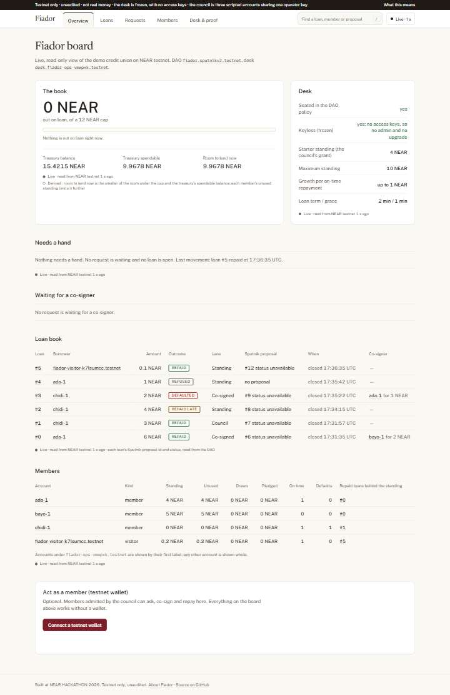
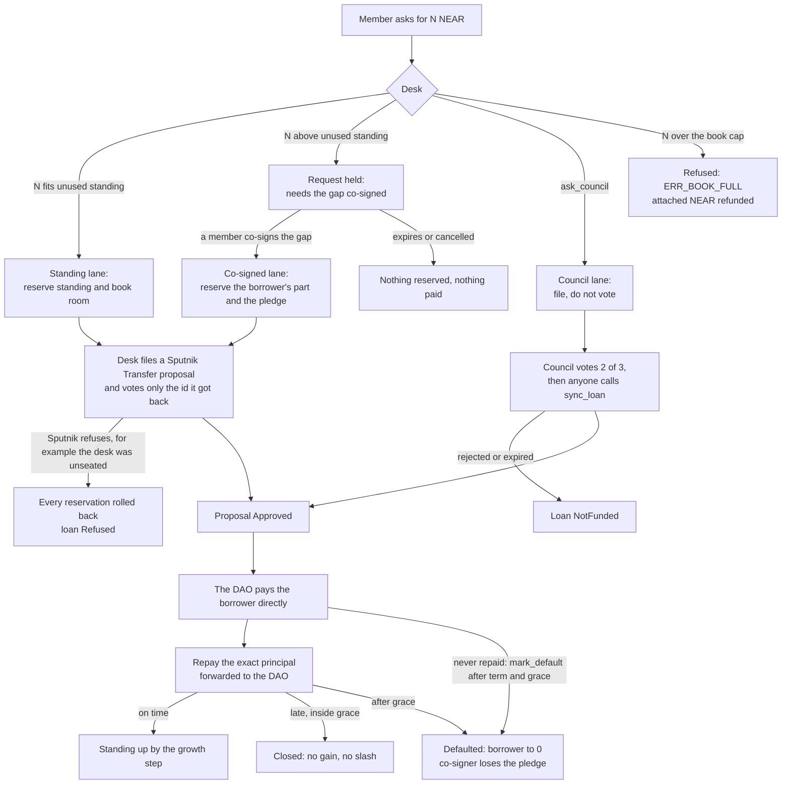

<!-- readme-schema: R2-contract-protocol v1 -->
<div align="center">

# Fiador

**The desk files the loan. The DAO pays it. Repaying on time raises the limit.**

A credit union seat for Sputnik DAOs: members borrow treasury NEAR within a limit earned by on-time repayment.

</div>

<div align="center">


</div>

A Sputnik DAO can only give money away. Every payment out is a one-way payout, so a member who needs a short
float has to ask the whole council for a grant or go without. And nothing in the DAO remembers who paid back
last time.

Fiador adds a credit desk: one contract holding one narrow seat in the DAO's own policy. Within a member's
standing, the desk files a native Sputnik Transfer proposal and approves it in the same transaction chain, so
the treasury pays the member directly. Above that, another member co-signs the gap. Anything bigger goes to the
council. The desk never holds the money.

[Demo video](#demo) · [Live board](https://dotman-bei.github.io/fiador/app/) · [Evidence](#live-evidence) · [Verify it yourself](#verify-it-yourself) · [Run locally](#run-locally)

> **Stage: hackathon build, testnet only, unaudited.** The council is three scripted accounts that share one
> operator key, so the 2-of-3 vote is a real on-chain mechanism run by one person. Loans #0 to #6 were made by
> scripts. Loans #7 to #11 were asked for and repaid from one builder-owned testnet wallet in the browser
> (Meteor Wallet); #10 and #11 were filmed live. Co-signing from the browser was never run. Nothing below is
> claimed beyond what the [live evidence](#live-evidence) supports.

## Demo

[](https://x.com/Heisbei02/status/2121636848644563439)

**[Watch the demo on X](https://x.com/Heisbei02/status/2121636848644563439)** (2:09). The landing page's
problem, then a live ask and repay from a real testnet wallet on the board (loan #11, Sputnik proposal 21),
the co-signed loan #0 from the scripted run, the defaulted loans #3 and #7, the board's "Desk and proof"
checks turning to Pass, and `npm run verify` in a terminal.

- Demo video (2:09, attached to the X post): https://x.com/Heisbei02/status/2121636848644563439
- Live board (read-only, no wallet): https://dotman-bei.github.io/fiador/app/ (landing page: https://dotman-bei.github.io/fiador/)
- Screenshot of the board's overview: [`docs/design/screenshots/acceptance/overview-1440.jpg`](docs/design/screenshots/acceptance/overview-1440.jpg) (taken at the redesign, before the testnet notice moved from a top bar into the footer)

### Explore without a wallet

Every page below is public, reads the DAO and the desk live over testnet RPC, and needs no account.

| Where | What you see | Needs a wallet |
|---|---|---|
| [`#/`](https://dotman-bei.github.io/fiador/app/#/) | Overview: the book against its cap, the treasury balance, the desk panel, anything that needs a hand, the waiting list and the loan book | No |
| [`#/loans`](https://dotman-bei.github.io/fiador/app/#/loans) | Every loan, filterable by lane, outcome and member; each one opens on its proposal chain, as in [`#/loans/11`](https://dotman-bei.github.io/fiador/app/#/loans/11) | No |
| [`#/requests`](https://dotman-bei.github.io/fiador/app/#/requests) | Asks held for a co-signer, and expired ones not yet cleared | No |
| [`#/members`](https://dotman-bei.github.io/fiador/app/#/members) | Every member's standing; each opens on a passbook of the loans behind it | No |
| [`#/desk`](https://dotman-bei.github.io/fiador/app/#/desk) | "Desk and proof": the DAO policy as read, the desk's keys and parameters, and every `verify` check, run in the browser | No |
| The wallet panel on Overview and Requests | Ask, co-sign, repay and cancel, for council-admitted members | Yes, a testnet wallet |

### Contents

- [Why this exists](#why-this-exists)
- [Verify it yourself](#verify-it-yourself)
- [Run locally](#run-locally)
- [Architecture](#architecture)
- [The mechanism, step by step](#the-mechanism-step-by-step)
- [Live evidence](#live-evidence)
- [Engineering decisions and hard problems](#engineering-decisions-and-hard-problems)
- [What is real and what is not](#what-is-real-and-what-is-not)
- [How this could be misleading](#how-this-could-be-misleading)
- [Trust boundaries](#trust-boundaries)
- [Repository map](#repository-map)
- [Attribution and further reading](#attribution-and-further-reading)

## What it does

A community that keeps its money in a Sputnik DAO can only give it away: every payment out is a one-way payout, so a member who needs a short float has to ask the whole council for a grant or go without. Fiador adds a credit desk to the DAO. The desk is one contract holding one narrow seat in the DAO's own policy, and it lends treasury NEAR to members as native Sputnik Transfer proposals. A loan within a member's standing is filed and approved at once; a larger one is held until another member co-signs the gap with their own standing; anything bigger goes to an ordinary 2-of-3 council vote. Every repayment returns to the same treasury, on-time repayments raise standing, and defaults zero it and slash the co-signer's pledge.

### Why this exists

Sputnik DAO and Trezu have no amount tiers, no automatic approval for trusted members, no limits and no record
of who kept their word. A short loan to a known member is the oldest thing a credit union does, and a DAO
can't do it.

The two obvious fixes both fail. **Vote every loan as a grant** and the council sits through a 2-of-3 vote for
every small float, while a repayment is just a deposit: nobody's record improves, so the next loan is no easier.
**Move the money into a lending contract** and a second contract now holds the treasury, with its own admin,
outside the multisig the community chose.

Fiador does neither. The money stays in the DAO, every loan is the DAO's own Transfer proposal, and the desk's
power is a single seat that the council grants and can take back.

*Fiador is Spanish and Portuguese for guarantor.*

## Quickstart

Needs Node 22.22.2 or newer. No wallet, no keys, no secrets.

1. Do `npm ci` - see the install finish with no errors.
2. Do `npm run verify` - see one `PASS` line per check (factory upgrades off, the desk seat holds only the desk with transfer rights only, a 2-of-3 council, the desk has no access keys, every loan matches its Sputnik proposal) and a final `VERIFY PASS (N checks, M loans)`. It reads public testnet RPC only.
3. Do `npm run web`, then open `http://localhost:5173/app/` - see the treasury, the "Waiting for a co-signer" list, the loan book with each loan's Sputnik proposal id and status, and every member's standing with the repaid loans behind it, read live from testnet. (The same board is hosted at https://dotman-bei.github.io/fiador/app/.)
4. Do `npm run visitor` - see a throwaway testnet account created from the public faucet join the visitor line, get its first ask held for a co-signer, borrow within its standing (paid by the DAO through a Sputnik proposal), repay, then `standing 0.1 -> 0.2 NEAR` and `VISITOR PASS`. Its key lives only in memory. If the public faucet or the visitor line is unavailable, it says so and exits without error; use step 2 instead.
5. Do `npm run cargo -- test --manifest-path contract/desk/Cargo.toml` (needs Rust 1.99.0; on Windows the launcher also needs MSYS2 at `C:\msys64`) - see `test result: ok. 96 passed`.

Optional: members admitted by the council can also ask, co-sign and repay from the board with a testnet wallet via NEAR Wallet Selector: Meteor Wallet, or MyNearWallet for accounts that already exist (it no longer creates new ones). Asking, repaying on time, a request held for a co-signer and cancelling it were run end to end with Meteor Wallet on testnet; co-signing from the board was not (see "Wallet run" in `docs/design/ACCEPTANCE_EVIDENCE.md`). None of the steps above needs a wallet.

If testnet RPC is unreachable, step 2 prints the RPC error; set `FIADOR_RPC` to another public testnet endpoint (https://docs.near.org/api/rpc/providers) and retry.

### Verify it yourself

From a clean clone, with no credentials:

```bash
git clone https://github.com/Dotman-Bei/fiador.git && cd fiador
npm ci

npm run verify     # reads the live DAO and desk; on 2026-11-14: VERIFY PASS (24 checks, 12 loans)
npm run cargo -- test --manifest-path contract/desk/Cargo.toml   # 96 passed
```

`verify` never signs anything. It checks the DAO policy, the factory setting, the desk's access keys and every
loan against the Sputnik proposal that paid it, and exits 1 on any failing line. The same checks run in the
browser on the board's [`#/desk`](https://dotman-bei.github.io/fiador/app/#/desk) page.

### Run locally

```bash
npm ci
npm run web        # the landing page at http://localhost:5173/ and the board at /app/
```

The board, `verify` and `visitor` need no env vars. Only the operator scripts that sign (`root`, `smoke`,
`seed`, `story`, `admit`, `params`, `freeze`) read a git-ignored `.env`; names are in `.env.example`, values
are never committed.

| Variable | Purpose |
|---|---|
| `FIADOR_ROOT` | the operator's testnet root account; the council, desk and persona accounts are its sub-accounts |
| `FIADOR_ROOT_KEY` | that account's secret key, used only by the signing scripts; lives only in `.env` |
| `FIADOR_RPC` | the testnet RPC endpoint; `verify` and `visitor` also read it, from the shell |
| `FIADOR_DAO_NAME` | the DAO's name under `sputnikv2.testnet` |
| `FIADOR_FAUCET_URL` | the public testnet faucet helper used by `root` and `visitor` |
| `FIADOR_MINGW_BIN` | Windows only, read from the shell by `tools/cargo.ts`: where MSYS2's mingw64 tools live |

## Built at NEAR HACKATHON

- Event: NEAR HACKATHON (https://nearhackathon.com/), development window ending 2026-11-14 23:59 UTC.
- Track: Social Money (`social`).
- Team: one builder working with Claude Code (AI-written code, reviewed and gated by the builder).
- Built during the event: everything in this repository (created 2026-11-13), the desk contract, the scripts, the board and the landing page. The Sputnik DAO contract and factory are used as deployed on testnet (`sputnikv2.testnet`, DAO version 2.3.1), unmodified.

## Contract addresses

| Network | Account | What it is | Explorer |
|---|---|---|---|
| testnet | `sputnikv2.testnet` | Sputnik DAO factory (not ours) | https://testnet.nearblocks.io/address/sputnikv2.testnet |
| testnet | `fiador.sputnikv2.testnet` | the demo DAO (Sputnik 2.3.1, bond 0, 3-member council) | https://testnet.nearblocks.io/address/fiador.sputnikv2.testnet |
| testnet | `desk.fiador-ops-vmwpxk.testnet` | the Fiador desk contract (keyless) | https://testnet.nearblocks.io/address/desk.fiador-ops-vmwpxk.testnet |

`deployments/testnet.json` holds the same ids; `verify` and the board read them from there.

## How it works

- **The seat.** The DAO policy has a `desk` role whose only member is the desk account, with exactly two permissions: `transfer:AddProposal` and `transfer:VoteApprove`, and a vote policy of 1 for transfers. Nobody else outside the council can add proposals. The council (3 accounts) needs 2 approvals for every proposal kind.
- **Standing.** Each member has a standing (a credit limit in NEAR), admitted by the council through an ordinary `FunctionCall` proposal to the desk's `admit_member`. Unused standing is standing minus what the member has drawn and minus what they have pledged for others.
- **Three lanes.**
  - Standing lane: `ask(amount)` within unused standing and the book cap. The desk reserves the standing and book room first, files a `Transfer` proposal on the DAO (attaching exactly the policy bond), and then votes to approve only the proposal id its own `add_proposal` call returned. The desk's single vote passes, and the DAO pays the borrower directly.
  - Co-signed lane: an ask above unused standing is held as a request ("needs N co-signed") that expires after a DAO-set window. One member covers the whole gap with `cosign(borrower, max_pledge)`, and the loan is filed and approved inside that co-signer's transaction. The pledge stays locked until repayment.
  - Council lane: `ask_council(amount)` files the proposal without voting; the council votes it 2-of-3; anyone then calls `sync_loan` and the desk tracks it as a loan.
- **Repayment.** `repay(loan_id)` with exactly the principal attached forwards the NEAR to the DAO in the same transaction chain. Settlement is by the timestamp of that call: on time, the borrower's standing grows by min(step, principal) and the co-signer's by min(step, pledge), capped at the maximum; after the term but within grace, the loan closes with no gain and no slash; after the grace period, the money still returns but the loan counts as defaulted.
- **Default.** After term plus grace, anyone can call `mark_default`. The desk first reads the proposal back from Sputnik and only slashes if the payout shows `Approved`: the borrower's standing goes to 0 and the co-signer loses exactly what they pledged.
- **Governed by the multisig it sits on.** The council seats the desk, admits members, sets every parameter (starter and maximum standing, growth step, book cap, term, grace, request window, visitor line) and can unseat the desk, all through ordinary Sputnik proposals; the desk accepts those calls only from the DAO account. After the council unseats it, the next ask fails inside Sputnik with `ERR_PERMISSION_DENIED`.
- **Visitor line.** So anyone can try it without a council vote, the desk runs a small capped line of visitor seats: a visitor attaches a 0.05 NEAR storage deposit (refunded when the seat is recycled), starts at 0.1 NEAR standing, takes at most 3 loans and cannot co-sign or use the council lane. Seats recycle after 30 minutes when nothing is open.
- **No custody, no indexer.** The desk never holds loan funds. The board and `verify` read paginated public views.

### Architecture



The DAO is the custody and the multisig the whole time. The desk's power is one seat in the DAO's policy, and the
council can take it back with an ordinary proposal.

### The mechanism, step by step

The numbers below are the live desk's parameters, read with `get_config` on 2026-11-14.

**1. Seat.** The DAO's policy gives the `desk` role exactly `transfer:AddProposal` and `transfer:VoteApprove`,
with a threshold of 1 for transfers. Sputnik enforces that, not the desk: the desk can't add or vote on any other
proposal kind.

**2. Admit.** The council admits a member with an ordinary `FunctionCall` proposal to `admit_member`. A new
member starts at 4 NEAR of standing; the maximum is 10.

**3. Ask.** The member calls `ask(amount)`. If it fits their unused standing and the book's 12 NEAR cap, the desk
reserves both **before** it makes any cross-contract call.

**4. File.** `file_transfer` is the only code that writes to Sputnik. It calls `add_proposal` with a `Transfer`
of exactly the principal to the borrower, attaching exactly the policy bond (0 on the demo DAO).

**5. Approve.** In `on_filed`, the desk parses the proposal id out of **its own** `add_proposal` result and
votes `VoteApprove` on that id and nothing else. Its single vote passes the proposal, and Sputnik pays the
borrower from the treasury. The desk never touches the NEAR.

**6. Hold and co-sign.** An ask above unused standing becomes a held request that names the gap and expires
after 600 s. One other member covers the whole gap with `cosign`; filing and approval then run inside that
member's transaction, and the pledge stays locked until repayment.

**7. Repay.** `repay(loan_id)` with exactly the principal forwards it to the DAO in the same transaction chain.
The timestamp of that call settles the loan: inside the 600 s term, standing grows by up to 1 NEAR for the
borrower and the co-signer; inside the 300 s grace, it closes flat; after grace, the money still returns and the
loan counts as defaulted.

**8. Default.** After term plus grace, anyone can call `mark_default`. The desk reads the proposal back from
Sputnik first and only slashes on an `Approved` payout: the borrower's standing goes to 0 and the co-signer
loses exactly the pledge. **Nobody is slashed for a loan they never received.**

**9. Govern.** The council can change any parameter, admit or remove members, or unseat the desk, all through
ordinary proposals. Once the desk is unseated, Sputnik itself refuses the next ask.

### Live evidence

One row per property. Every link opens a loan on the hosted board (which reads the chain live) or a
transaction on the public testnet explorer. Ids and times were read back by RPC on 2026-11-14.

| Property | Level | Evidence |
|---|---|---|
| A member asks from a browser wallet, the DAO pays through the desk's own proposal, and the member repays on time | `LIVE_WALLET` | [Loan #11](https://dotman-bei.github.io/fiador/app/#/loans/11), proposal 21, 2 NEAR to `goodkale2741.testnet`: [ask](https://testnet.nearblocks.io/txns/Ag6gan3WNEiEsDub75Mp1ZH7t76zoCau31w3z6weXMNT) 14:29:08 UTC, [repay](https://testnet.nearblocks.io/txns/BAiXsVJnq3YmughWLUwSNTWNJaYGydk1UnRYUMBHAk4k) 14:29:49 UTC, repaid in 41 s against a 14:39:10 due time; standing 7 to 8 |
| The same, first live take | `LIVE_WALLET` | [Loan #10](https://dotman-bei.github.io/fiador/app/#/loans/10), proposal 20, 2 NEAR: [ask](https://testnet.nearblocks.io/txns/EtAHWWiu5WmkYWMGwJeLgtheMNye5a53eTb8P66HDhYx) 14:22:41 UTC, [repay](https://testnet.nearblocks.io/txns/vr6MZ8zdN9VQ7JuEjR733ub5XMVWuDpdJqhbXwrLpNi) 14:23:17 UTC; standing 6 to 7 |
| An ask above standing is held for a co-signer, then cancelled, from the wallet | `LIVE_WALLET` | [held](https://testnet.nearblocks.io/txns/oGbNztxr64b7PYEw6GrG8oefHDhohVKqeTfE3ygqye6) 7 NEAR with a 1 NEAR gap, [cancelled](https://testnet.nearblocks.io/txns/J3KrWPzT11rBFBZt6hjbDhuvHNjBVDj4ngMZNt6cK6QL); no loan opened |
| A repayment after term and grace settles as a default | `LIVE_WALLET` | [Loan #7](https://dotman-bei.github.io/fiador/app/#/loans/7), proposal 15, 3 NEAR: due 12:30:50 UTC under the old 120 s term, [repaid](https://testnet.nearblocks.io/txns/AxUGFNSjubPmU6cgfhvsnHxa4zPaa7AbWrXniZ2B9Tmh) 12:37:24 UTC, settled `Defaulted`, standing 4 to 0; the 3 NEAR returned to the DAO |
| A co-signer covers the gap and the loan is filed and approved inside the co-signer's transaction | `SCRIPTED_ON_CHAIN` | [Loan #0](https://dotman-bei.github.io/fiador/app/#/loans/0), proposal 6: `ada-1` asked 6 NEAR on 4 NEAR of standing, `bayo-1` pledged 2, [co-sign, file, approve and pay](https://testnet.nearblocks.io/txns/FG1CKxCY1U2hTPx3bXD5e2TE5hTViGXE8KKf6fGPo5Ad) in one chain; repaid on time |
| A council-lane loan passes 2-of-3 and is tracked by `sync_loan` | `SCRIPTED_ON_CHAIN` | [Loan #1](https://dotman-bei.github.io/fiador/app/#/loans/1), proposal 7, [ask_council](https://testnet.nearblocks.io/txns/66tC52wdaaj1mozY43EyupJAQqLN2jvP4VF6wpbeyrCo); repaid on time |
| `mark_default` slashes the borrower and exactly the co-signer's pledge | `SCRIPTED_ON_CHAIN` | [Loan #3](https://dotman-bei.github.io/fiador/app/#/loans/3), proposal 9: `chidi-1` borrowed 2 NEAR, `ada-1` pledged 1; [mark_default](https://testnet.nearblocks.io/txns/9GopnLKWmUhRKVrL9s37htFsfDLMYu6TxHzT84Nt9Bvn) 17:35:22 UTC on 2026-11-13; `chidi-1` to 0, `ada-1` 5 to 4 |
| An unseated desk is refused by Sputnik itself | `SCRIPTED_ON_CHAIN` | [Loan #4](https://dotman-bei.github.io/fiador/app/#/loans/4), [refused ask](https://testnet.nearblocks.io/txns/3VWv9j8UeMF9KqDNhSMnYE5EQTXNvikYgWCicF2mfCQN): `ERR_PERMISSION_DENIED` from Sputnik; the desk was re-seated afterwards |
| The council changes the desk's parameters through an ordinary proposal | `SCRIPTED_ON_CHAIN` | Proposal 16, `set_params`, term 120 to 600 s and grace 60 to 300 s: [filed](https://testnet.nearblocks.io/txns/Hzj65zY86dZsEdX1RDJ712c4EdQtdx2MMYUMSDj3SmXY) by `council-1`, [approved](https://testnet.nearblocks.io/txns/2ggxtUnDPxnL2ogmPoB9U2iYkM9Wdp6qFXGonAq3BNvf) by `council-1`, [executed](https://testnet.nearblocks.io/txns/GbmdzHCrZMgabkbMWrgEuahmuGygTngueTa9tYQ7o1Es) on `council-2`'s approval; `get_config` reads 600 / 300 |
| The desk has no access keys: no owner, no upgrade | `SCRIPTED_ON_CHAIN` | [delete key](https://testnet.nearblocks.io/txns/2WCjkuZJ6J8pjZEjYM8DXn2Jb1o5ntLkMy4v5uWG7iQ1) 2026-11-13 17:42:43 UTC; [`#/desk`](https://dotman-bei.github.io/fiador/app/#/desk) and `npm run verify` read 0 keys |
| Every step of the ask chain can fail and the reservation rolls back exactly | `UNIT_TESTED` | 96 cargo tests in [`contract/desk/src/tests/`](contract/desk/src/tests/), including [`ask_chain.rs`](contract/desk/src/tests/ask_chain.rs) and [`gas_headroom.rs`](contract/desk/src/tests/gas_headroom.rs) |
| Co-signing from the browser board | **`NOT_RUN`** | needs a second admitted wallet account; none existed. The co-signed lane is proven only by the scripted loan #0 |

The wallet run is written up with every step and its chain read-back in
[`docs/design/ACCEPTANCE_EVIDENCE.md`](docs/design/ACCEPTANCE_EVIDENCE.md#wallet-run); every scripted and
gated action is in [`docs/gates/2026-11-13-gate-ledger.md`](docs/gates/2026-11-13-gate-ledger.md).

### Engineering decisions and hard problems

The full decision table is section 1 of [the design spec](docs/superpowers/specs/2026-11-13-fiador-design.md).
The ones that shaped the desk:

**The desk votes only the id its own `add_proposal` returned** (spec section 4.3). An id taken from anywhere
else could point at a proposal the desk never filed. The id comes out of the `on_filed` callback's promise
result, and the guide's security review of the desk core checked that path before the seed
([runsheet](docs/guide/2026-11-13-near-hackathon-runsheet.md), "Guide security review of the desk core").

**Reserve, then file** (D19, D24). Standing, pledge and book room are reserved before any cross-contract call,
and every callback either commits or rolls back exactly. NEAR's calls are asynchronous, so other asks can land
between `add_proposal` and its callback; reserving later would let two asks spend the same standing. Unit tests
fail each step of the chain and check the rollback.

**A failed vote becomes a council-lane loan** (D27). If the desk's `act_proposal` vote fails, every reservation
is released and the loan waits for the council like any `ask_council` loan, instead of leaving a filed proposal
nobody tracks.

**Hold the request, don't refuse it** (D1, D4). The original brief had the desk refuse an ask above standing.
The spec changed that to "the desk holds the request: needs N co-signed", so a co-signer has something to sign.

**Gas headroom tested against the chain** (D28). The smoke run measured the real `add_proposal` to
`act_proposal` chain on testnet ([`deployments/smoke-gas.json`](deployments/smoke-gas.json)), and a unit test
asserts every static gas constant is at least 1.3 times that. A callback that runs out of gas strands a loan
(see the Roadmap).

**Keyless freeze** (D7, D12). After the scripted story run passed, every access key on the desk was deleted.
"No other admin" is then a fact `verify` can check, not a promise. The cost: a fix is a new desk the council
seats.

#### Two problems worth recording

**A 120 s term nobody could meet from a browser wallet.** Loan #7 was asked at 12:28:48 UTC and due at
12:30:50. Meteor signs a call with no deposit in the page, but `repay` attaches NEAR, so it waits for approval in
the Meteor extension. The old panel kept saying "Opening your wallet for repay…" with no hint. The first attempt
sent nothing; the repay that landed came at 12:37:24, past grace, and the desk settled it `Defaulted` exactly as
`settle` in [`contract/desk/src/repay.rs`](contract/desk/src/repay.rs) is written. It wasn't a contract bug.
The council raised the term to 600 s and the grace to 300 s with proposal 16, and after 8 s the panel now says
nothing is sent until the wallet approves ([`web/src/wallet/status.ts`](web/src/wallet/status.ts)). Loan #7
stays in the book as a real default. Recorded in
[`docs/design/ACCEPTANCE_EVIDENCE.md`](docs/design/ACCEPTANCE_EVIDENCE.md#wallet-run), items 4 and 5.

**Meteor's SDK assumes Node.** Its chunk crashed on load because its `randombytes` reaches Node's `Buffer`, and
the first live ask failed with "Buffer is not defined" (nothing was sent). `randombytes` is now aliased to a Web
Crypto stand-in ([`web/src/wallet/randombytes.ts`](web/src/wallet/randombytes.ts)) and `buffer` 6.0.3 is set as
the global `Buffer` inside the Meteor loader only. Same document, items 2 and 3.

## Security notes

- Unaudited hackathon code on testnet. Do not use it with real funds.
- The desk is the security-sensitive part: one routine (`file_transfer`) is the only code that writes to Sputnik, and the desk votes only on the proposal id returned by its own `add_proposal` call. Every reservation is made before any cross-contract call, and every callback either commits or rolls back exactly; unit tests fail each step of that chain and check the rollback.
- Keyless freeze: after the demo story run, every access key on the desk account was deleted. The desk has no owner and no upgrade path; its only admin is the DAO, through proposals. `npm run verify` checks that the desk has zero access keys.
- The factory's auto-upgrade of the demo DAO was switched off by a council proposal, so the DAO's code and JSON shapes cannot change under the desk.
- The demo council is three scripted accounts sharing one operator key. It demonstrates the on-chain 2-of-3 mechanism; it is not three independent people.
- Refusals are panics, so the runtime refunds any attached NEAR (wrong repayment amount, inactive loan, wrong visitor deposit).

### What is real and what is not

| | Status |
|---|---|
| The desk contract | **Real.** Rust, near-sdk 5.30.1, deployed on testnet at `desk.fiador-ops-vmwpxk.testnet`, keyless |
| Sputnik DAO | **Real and unmodified.** The deployed `sputnikv2.testnet` factory, DAO version 2.3.1 |
| Standing lane | **Real**, from a browser wallet (loans #7 to #11) and from scripts |
| Co-signed lane | **Real on chain, scripted only** (loans #0 and #3). Never run from the browser |
| Council lane | **Real on chain, scripted only** (loan #1). Not in the board's wallet panel |
| Defaults and slashing | **Real.** By `mark_default` (loan #3) and by a late wallet repayment (loan #7) |
| Visitor line | **Real**, from the command line (loans #5 and #6) |
| The council | **Scripted.** Three accounts, one operator key |
| Wallet sign-in | **Real** with Meteor Wallet. MyNearWallet is offered for existing accounts and was never exercised |
| The board | **Real and read-only.** Reads public RPC live; no backend, no indexer |
| Audit | **None.** Unaudited |
| Money | **Testnet NEAR only** |

### How this could be misleading

Written here before anyone has to ask:

- The 2-of-3 council is **one operator**. Three accounts share one key. It shows the on-chain mechanism, not
  independent judgment.
- "From a browser wallet" means **one builder-owned account**, `goodkale2741.testnet`. No outside user has
  borrowed.
- Loans #0 to #6 were made by scripts that chose their inputs to walk every path. They prove the paths work, not
  that anyone wants them.
- Standing can be **pumped**: with no minimum loan age, a member can borrow and repay at once, gaining standing
  each round trip up to the maximum. A high standing shows repayments, not trustworthiness.
- Loan #11's 41 s repayment was a demo take, not a usage pattern.
- The 96 cargo tests run in near-sdk's mocked unit environment, not a sandbox. The cross-contract paths are
  proven live only where the evidence table says so.
- The screenshot above was taken at the redesign, under the old 2 min term, and shows loans #0 to #5 only. The
  hosted board shows the current book.

### Trust boundaries

1. **The council is the only admin.** Whoever holds 2 of the 3 council keys can admit and remove members,
   change every parameter and unseat the desk. On the demo DAO that's one operator key.
2. **The desk's reach is set by Sputnik, not by the desk.** Its role can only add and approve `Transfer`
   proposals. `verify` checks the policy says exactly that.
3. **The deployed desk can't be patched.** It's keyless; a bug means a new desk
   (`npm run seed -- --desk desk2.<root>`) that the council seats.
4. **Sputnik is trusted as deployed.** DAO version 2.3.1, unmodified, with the factory's auto-upgrade switched
   off, so its code and JSON shapes can't change under the desk.
5. **A payout can read `Approved` for a block or two before it turns `Failed`.** A repayment in that window is
   accepted; `sync_loan` voids such a loan afterwards.
6. **The board and `verify` trust the RPC endpoint they read.** Point `FIADOR_RPC` at another provider to
   cross-check.
7. **Wallet code runs in the browser.** The Meteor SDK loads only when someone picks Meteor Wallet, and it
   carries the `npm audit` advisories listed in the Roadmap.

## Build & test

- Contract: Rust 1.99.0 (pinned in `rust-toolchain.toml`), `near-sdk` 5.30.1, built for `wasm32-unknown-unknown` with `--cfg near` (set in `.cargo/config.toml`). Do `npm run cargo -- test --manifest-path contract/desk/Cargo.toml` for the 96 unit tests and `npm run wasm -- desk` to rebuild `contract/res/fiador_desk.wasm`. `tools/cargo.ts` puts MSYS2's mingw64 tools on PATH and sets `AWS_LC_SYS_PREBUILT_NASM=1` on Windows.
- TypeScript: do `npm run check` (strict `tsc`, then every vitest suite: 32 files, 176 tests) and `npm run web:check` (web tests: 13 files, 77 tests, then the production build of `/` and `/app/` into `dist/`). Counts as re-run on 2026-11-14, all passing.

### Libraries and tools

`near-sdk` 5.30.1 (Rust), `near-api-js` 7.5.3, NEAR Wallet Selector 10.1.4 (`@near-wallet-selector/core`, `@near-wallet-selector/meteor-wallet`, `@near-wallet-selector/my-near-wallet`) with `@near-js/transactions` 2.5.1 and `buffer` 6.0.3 (for the Meteor SDK), React 19.3, Vite 8.3, vitest 5.1, tsx 4.23, TypeScript 5.9. The Sputnik DAO v2 contract and factory are used as deployed on testnet. Code was written with Claude Code.

### Repository map

```
contract/
  desk/          the Fiador desk contract (Rust); its unit tests are in src/tests/
  smoke/         the seat-holding contract that proved the DAO policy live before the desk existed
  res/           committed wasm builds; fiador_desk.wasm is the code deployed on testnet
scripts/         root, smoke, seed, story, visitor, admit, params, freeze, verify (TypeScript, near-api-js)
  lib/           env loading, faucet, gas measurement, council propose and vote, run records
src/lib/         shared by the scripts and the web: RPC client, NEAR units, Sputnik types, desk views, verify
web/             the static site: the landing page (/) and the board (/app/), React and Vite
tools/           cargo launcher, wasm build and check, the README conformance check
deployments/     public ids and run records: testnet.json, smoke.json, smoke-gas.json, story-1.json
demo/            the demo film pipeline: capture, narration, render
docs/            spec, plans, design notes and evidence, gate ledger, runsheet, event pack
```

## Deploy

Testnet only. The scripts read env vars from a git-ignored `.env` (names in `.env.example`; values are never committed): `FIADOR_ROOT`, `FIADOR_ROOT_KEY`, `FIADOR_RPC`, `FIADOR_DAO_NAME`, `FIADOR_FAUCET_URL`.

1. `npm run root -- create <name>`, then `npm run root -- topup --count 2` until `npm run root -- check` prints `ROOT OK` (about 21 NEAR).
2. `npm run smoke` creates the DAO with the final policy and proves the seat can file and approve alone.
3. `npm run seed -- --desk desk.<root>` deploys and initialises the desk in one transaction, switches off factory upgrades, swaps the seat to the desk, sends the loan float and writes `deployments/testnet.json`.
4. `npm run story -- --run 1` runs the scripted story; `npm run story:check -- --run 1` checks it.
5. `npm run freeze -- --yes` deletes the desk's keys (permanent), then runs `verify`.

A fix after the freeze is a new desk: `npm run seed -- --desk desk2.<root>` deploys it and the council votes the seat over.

## Roadmap

Known limitations:

- The demo council is three scripted accounts sharing one operator key: it shows the on-chain 2-of-3 mechanism, not three independent people.
- Standing can be pumped instantly: there is no minimum loan age, so an admitted member can borrow a tiny amount and repay it at once, again and again, gaining standing on every round trip until the maximum. Exposure is bounded by the maximum standing per member and the book cap.
- The visitor line is anonymous credit: a visitor can take its 0.1 NEAR and never repay, and the seat recycles after the default, so the DAO can lose up to the visitor starter per seat per cycle. Kill switch: the council passes `set_params` with `visitor_slots = 0`.
- A loan can be stranded in `Filing` or `Voting` if one of its callbacks fails (out of gas or storage): `repay` and `mark_default` need an `Active` loan, so there is no on-chain recovery path for it. The council can still vote the proposal itself. Every static gas is set at least 1.3x the live measurement to make this unlikely.
- `npm audit` reports 5 high-severity advisories (`nanoid`, `decode-uri-component`) in browser code that is loaded only when someone picks Meteor Wallet on the board. None of it runs in `verify`, the scripts or the contract.
- The live loan term is 600 s with a 300 s grace period, set by council proposal 16. Loan #7 defaulted under the earlier 120 s term and 60 s grace; it stays in the book as an honest record.
- Co-signing from the browser board was not exercised with a real wallet. The co-signed lane is proven by the scripted run (loan #0, Sputnik proposal 6).
- Testnet only.
- Unaudited.
- The keyless freeze is permanent: the deployed desk can never be patched, only replaced by a new desk the council seats.
- No minimum loan: a member could create many tiny loans and bloat storage (the desk's and the DAO's; visitors are capped at 3 loans per seat).
- One co-signer per request in this version.
- Sputnik pays out in a detached step, so a payout can read `Approved` for a block or two before a failing transfer turns it `Failed`; a repayment in that window is accepted. `sync_loan` voids such a loan afterwards.

Next: amounts in NEP-141 stablecoins, several co-signers per request, and a Trezu custom template that files `ask` from Trezu's UI.

### Attribution and further reading

Built for NEAR HACKATHON, Social Money track. Custody, approvals and the multisig are
[Sputnik DAO v2](https://github.com/near-daos/sputnik-dao-contract), used as deployed on testnet; wallet
sign-in goes through NEAR Wallet Selector and Meteor Wallet.

| Document | What is in it |
|---|---|
| [`docs/superpowers/specs/2026-11-13-fiador-design.md`](docs/superpowers/specs/2026-11-13-fiador-design.md) | The design spec: 32 decisions with their source, the desk's state and methods, the DAO policy |
| [`docs/design/ACCEPTANCE_EVIDENCE.md`](docs/design/ACCEPTANCE_EVIDENCE.md) | The board's acceptance record and the wallet run, every step read back from the chain |
| [`docs/gates/2026-11-13-gate-ledger.md`](docs/gates/2026-11-13-gate-ledger.md) | Every human-gated action (faucet claims, deploys, the freeze, going public) with tx hashes |
| [`docs/guide/2026-11-13-near-hackathon-runsheet.md`](docs/guide/2026-11-13-near-hackathon-runsheet.md) | The build runsheet, including the security review of the desk core before the seed |
| [`docs/demo/2026-11-14-demo-script.md`](docs/demo/2026-11-14-demo-script.md) | The demo film's script, its chain checks and its QC record |
| [`docs/idea-forge/2026-11-13-good-standing-brief.md`](docs/idea-forge/2026-11-13-good-standing-brief.md) | The original brief, written under the working name Good Standing |
| [`docs/superpowers/plans/`](docs/superpowers/plans/) | The seven build plans the code was written from |
| [`deployments/`](deployments/) | Public ids and the records of the smoke, seed and story runs |

## License

MIT, see `LICENSE`.

No token is launched. No secret appears anywhere in this repository.

> Fiador doesn't ask a DAO to trust a lender. It gives the DAO's own vote one narrow seat, writes down who paid
> back, and lets the council take the seat away.
